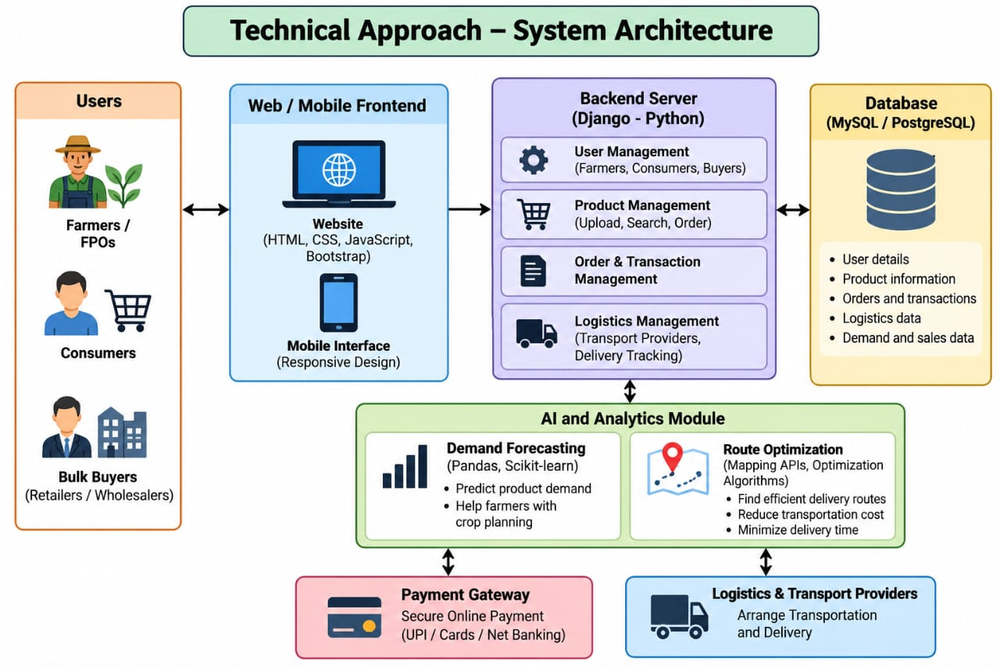

# Smart India Hackathon Workshop
# Date:
## Reference Number:26019647
## Name:Dharun Vijay RV

## Problem Title
SIH 26033: Multiple intermediaries reduce farmers earnings and increase consumer prices.

## Problem Creater's Organization
Ministry of Consumer Affairs, Food & Public Distribution

## Theme
Agriculture, FoodTech & Rural Development

## Problem Description
Expected Solution: Create a digital marketplace that:

• Connects farmers/FPOs directly with consumers and bulk buyers.
• Provides logistics support.
• Uses AI for demand forecasting and route optimization.

Benefits:

• Better prices for farmers.
• Lower prices for consumers.
• Reduced supply chain inefficiencies.

## Proposed Solution

1. Develop a digital marketplace that directly connects farmers and Farmer Producer    Oraganisation(FPOs) with consumers,retailers,wholesalers,bulk buyers.
2. Provide logistics support to arrange transportation and timely delivery of agricultural products
3. Provide a secure online payment system and order tracking facility

## Technical Approach

1. Route Optimization:use mapping services and optimization algorithms to identify efficient delivery routes
2. Security:Implement user authentication ,role based access,encrypted communication and secure payment processing

## Feasibility and Viability

1. The system can be developed using existing web technologies and open source software
2. Open source technologies reduce initial software development costs
3. The platform can expand gradually to more farmers,locations and product categories

## Impact and Benefits

1. Better prices by selling directly to buyers, reduce dependence on middlemen,access to wider markets and more customers and improved crop planning through AI- based demand predictions
2. reduced wastage of perishable agricultural products ,improved transportation and delivery efficiency,better coordination between farmers,buyers and transport providers and greater transparency in product pricing and availability

## Research and References

1. Food and Agriculture Oraganisation(FAO),website:fao.org
   National Agriculture Market(e-NAM),website:enam.gov.in